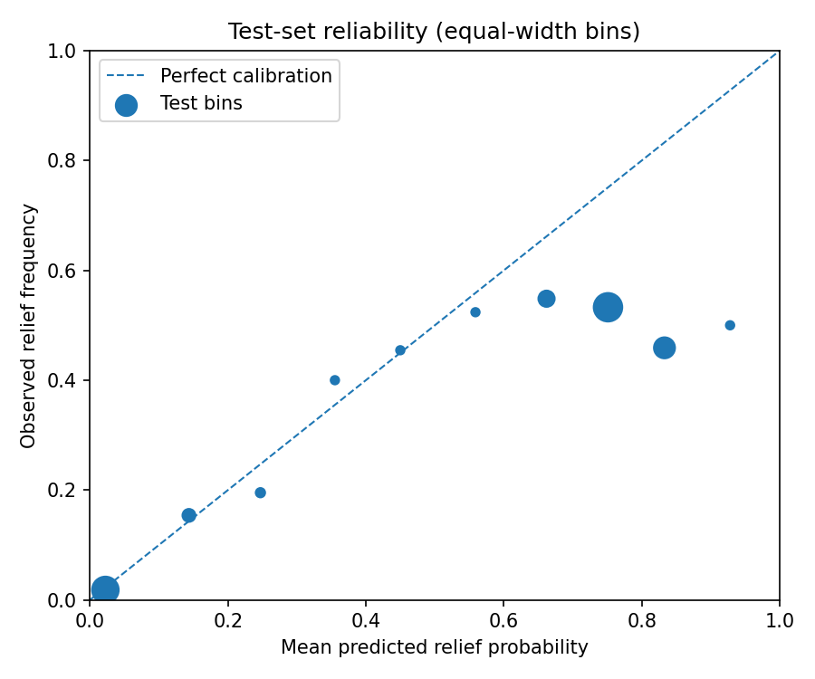
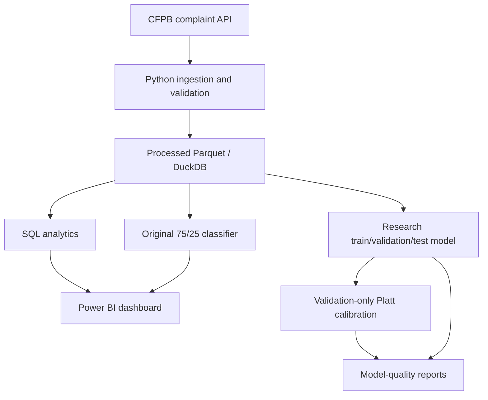

# Consumer Finance Complaint Intelligence

[](https://github.com/RishiRatnakarData/consumer-complaint-intelligence/actions/workflows/ci.yml)

**Consumer-finance analytics with reproducible Python/SQL pipelines, DuckDB, tested statistical models, probability calibration, and Power BI.** This repository analyzes a 2025 CFPB complaint detail sample and documents a separate, previously generated population-level reporting layer.


## At a glance — reproducible local results (October 22, 2026)

| Measure | Reported result | Scope |
|---|---:|---|
| Validated complaint detail records | **5,000** | Reused 2025 processed CFPB sample; selection was not reverified on this run |
| Automated tests | **53 passed** | User's Windows environment, v0.4 |
| Original classifier ROC-AUC | **0.7327** | Separate chronological 75/25 split, 1,250 test records |
| Research classifier ROC-AUC | **0.7292** | Chronological train/validation/test, 1,222 test records |
| Uncalibrated research Brier score | **0.2167** | Research test records, before calibration |
| **Platt-calibrated research Brier score** | **0.1833** | Same research test records; calibrator trained on validation only |
| Constant-probability Brier score | **0.2371** | Train-prevalence baseline on research test records |

The Brier score improved **15.4% relative to the uncalibrated research model** in this held-out sample. This is **not** a claim of improved ranking, business impact, or superiority over the original 75/25 model, which uses different training windows. [Full findings and limitations](docs/CFPB_RESEARCH_FINDINGS_v0.5.md).

## Business question and analytical approach

Can intake-time complaint attributes provide a useful estimate of whether a complaint will receive a response category containing **monetary or non-monetary relief**, and how stable are those probability estimates on later records?

1. Collect and validate CFPB complaint-level details; handle API pagination and duplicates.
2. Normalize records, enforce data-quality checks, and persist Parquet plus DuckDB/SQL analytical models.
3. Train a leakage-conscious logistic regression using intake-related categorical fields.
4. Evaluate on later records; calibrate probabilities using a separate validation window; report reliability, discrimination, thresholds, and subgroup limitations.
5. Communicate analytics through a three-page Power BI report and versioned evidence.



[Calibrated reliability chart](docs/evidence/2026-10-22/calibrated_test_reliability.png) · [Research findings](docs/CFPB_RESEARCH_FINDINGS_v0.5.md) · [Model card](docs/CFPB_MODEL_CARD_v0.5.md) · [Case study](docs/CFPB_CASE_STUDY_v0.5.md)

## Critical distinction: population totals versus modeling sample

Earlier dashboard documentation reported **5,442,964 complaints in a 2025 population-level monthly aggregate analysis**. That aggregate was produced separately from the complaint-detail sample and **was not refreshed or independently revalidated in the October 22, 2026 run**: the optional trends endpoint did not provide usable data. The latest summary explicitly records `official_counts_status: skipped` and `official_period_complaints: null`. Do not present the archived aggregate as an updated population count or as the model's training size. Existing dashboard screenshots illustrate the earlier reporting layer and are not proof of current live aggregates.

The present evaluation uses **only 5,000 processed complaint records**. The systematic weekly-stratified sample is not a random probability sample; sample and company proportions should not be generalized to all complainants.

## Machine-learning results

### A. Original model: chronological 75/25 holdout

| Metric | Value |
|---|---:|
| Train / test | 3,750 / 1,250 |
| ROC-AUC | 0.7327 |
| Average precision | 0.4807 |
| Accuracy | 0.6760 |
| Balanced accuracy | 0.7350 |
| Precision / recall | 0.5138 / 0.9202 |
| F1 | 0.6594 |
| Confusion matrix (TN / FP / FN / TP) | 453 / 371 / 34 / 392 |

### B. Additional research experiment: three disjoint chronological windows

| Split | Count | Received dates |
|---|---:|---|
| Train | 3,026 | 2025-01-07 to 2025-08-12 |
| Validation | 752 | 2025-08-19 to 2025-10-07 |
| Test | 1,222 | 2025-10-14 to 2025-12-31 |

| Metric | Uncalibrated | Platt-calibrated |
|---|---:|---:|
| ROC-AUC | 0.7292 | 0.7292 |
| Average precision | 0.4759 | 0.4759 |
| Brier score (lower better) | 0.2167 | **0.1833** |
| Log loss (lower better) | 0.6053 | **0.5186** |
| Ten-bin expected calibration error (lower better) | 0.1484 | **0.0823** |

**Threshold caveat:** raw-model threshold `0.65`, selected using validation to target at least 80% recall, achieved **81.7% test recall** with **55.2%** of the test set flagged. The calibrated model at threshold `0.50` achieved **31.9% test recall**, flagging **24.8%**. These are *different operating points*, not a fair like-for-like comparison of triage performance. The probability-calibration improvement does not justify automated complaint decisions.

## Feature availability and quality controls

The fitted model uses **company, product, sub-product, issue, state, and submission channel**. `has_narrative` was excluded because it is constant (`0`) in all 5,000 processed records. Missing publicly released narrative text **does not establish** that no consumers submitted narratives. Feature inclusion is decided from the training period only.

The latest run passed five processed-data quality checks and 53 automated tests. The sample was reused locally and the monthly-aggregates download was skipped, both recorded explicitly. The tests and workflow do not establish production SLAs, deployment readiness, real-time data freshness, or causal validity.

## Architecture



[Architecture notes](docs/architecture.md) · [Power BI documentation](docs/power_bi.md)

## Reproduce locally (Windows PowerShell)

```powershell
py -3.12 -m venv .venv
.\.venv\Scripts\Activate.ps1
python -m pip install -r requirements.txt
python -m pip install -r requirements-quality.txt
python -m pytest -q
python -m ruff check src tests
```

**Offline demonstration only:**

```powershell
python -m src.pipeline --sample
```

**If you already have the 2025 real processed detail dataset:**

```powershell
python -m src.pipeline --reuse-processed --skip-official-counts --start-date 2025-01-01 --end-date 2025-12-31
python -m scripts.evaluate_real_cfpb --data data/processed/complaints.parquet --out artifacts/model_quality_real --data-kind cfpb_sample
```

`--sample` overwrites the processed Parquet with a 12-row fixture; do **not** run it immediately before real-data evaluation. Rebuilding live details from the CFPB API may yield changed results or an error because the source data and endpoints can change. The generated data and complaint-level predictions are intentionally ignored by Git.

## Power BI pages

| Page | Focus |
|---|---|
| [Executive Overview](docs/images/dashboard_overview.png) | Archived population-level monthly trends alongside sampled outcomes; historical snapshot |
| [Company Benchmark](docs/images/company_benchmark.png) | Descriptive response comparisons; **not** company rankings |
| [Product and Issue Detail](docs/images/product_issue_detail.png) | Sample issues and product breakdowns |

## Repository structure

```text
src/                      data ingestion, transformations, original/research modeling
cfpb_quality/             reusable probability, calibration, and reporting utilities
scripts/                  data-evaluation CLIs and offline demonstration
sql/                      analytics views
artifacts/                generated data and results (ignored by Git)
docs/                     methodology, limitations, dashboard notes, aggregate evidence
docs/evidence/2026-10-22/ versioned non-row-level research evidence
tests/ and tests_quality/ offline validation and regression tests
.github/workflows/        continuous-integration checks
```

## Limitations and appropriate use

- The target is the **recorded company-response relief category**, not independently verified compensation or consumer benefit.
- Company, product and time distributions may shift; train prevalence was **45.1%** versus test prevalence **34.4%**.
- Company-specific results vary greatly and some groups have only one recorded target class. No ranking or fairness conclusion is warranted without further study.
- Response labels can be delayed or revised; chronological splitting of the *received date* does not guarantee truly point-in-time labels.
- The project is research and analytical decision support, **not** a deployed, automated complaint-disposition tool.
- Historical aggregate claims and dashboard screenshots predate the latest evaluation run.

[Source evidence and exact methodological caveats](docs/CFPB_RESEARCH_FINDINGS_v0.5.md)

## Data source and author

[Consumer Financial Protection Bureau Consumer Complaint Database](https://www.consumerfinance.gov/data-research/consumer-complaints/)

Rishi Ratnakar · [LinkedIn](https://www.linkedin.com/in/rishi-ratnakar) · [GitHub](https://github.com/RishiRatnakarData)
