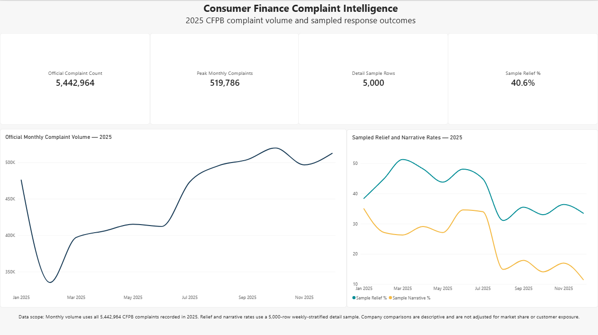
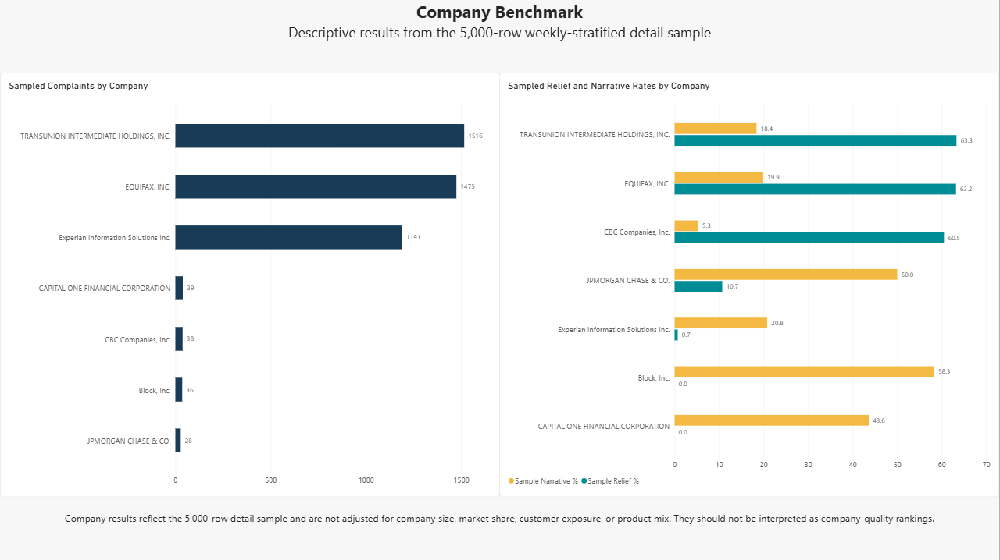
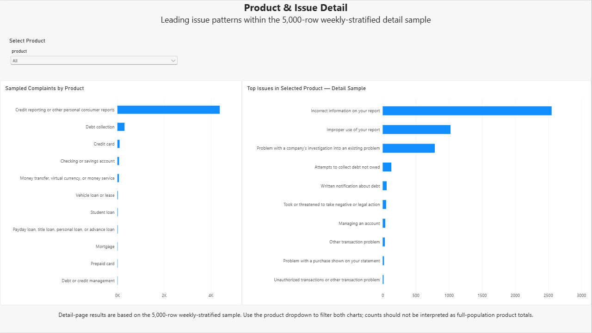
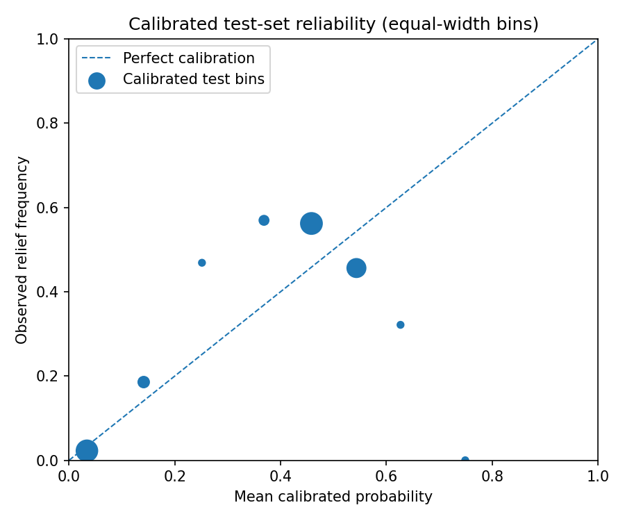
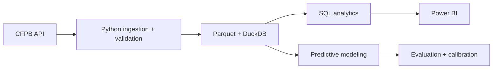

# Consumer Finance Complaint Intelligence

**An end-to-end consumer-finance analytics project combining API data engineering, SQL analytics, Power BI, and predictive modeling.** Built around CFPB complaint records to examine trends, response outcomes, and the reliability of complaint-level risk signals.

**Python · DuckDB · SQL · Power BI · scikit-learn · GitHub Actions**



[**Dashboard gallery**](#dashboard-gallery) · [**Results**](#selected-results) · [**Architecture**](#solution-architecture) · [**Research findings**](docs/CFPB_RESEARCH_FINDINGS_v0.5.md) · [**Model card**](docs/CFPB_MODEL_CARD_v0.5.md)

## Project overview

Consumer complaint data contains valuable signals about financial products, recurring customer issues, and company responses. This project brings those signals into a single analytical workflow: data ingestion and validation, query-ready storage, interactive reporting, and a statistically evaluated classification model.

The analysis covers a **5,000-record CFPB complaint detail sample from 2025**. A separate historical aggregate layer powers the dashboard's monthly population-level trend views. The two datasets serve different purposes and are not treated as interchangeable.

## Selected results

| Area | Result | Evidence |
|---|---|---|
| Data engineering | **5,000** processed complaint records; **5** data-quality checks passed | [Pipeline and architecture](docs/architecture.md) |
| Complaint composition | **87.6%** of the detail sample was credit-reporting complaints | [Dashboard gallery](#dashboard-gallery) |
| Original classifier | **0.7327 ROC-AUC** on a 1,250-record chronological holdout | [Model card](docs/CFPB_MODEL_CARD_v0.5.md) |
| Probability calibration | **0.1833 Brier score**, versus **0.2167** uncalibrated, on a separate 1,222-record research holdout | [Research findings](docs/CFPB_RESEARCH_FINDINGS_v0.5.md) |
| Engineering quality | **57 automated tests passed locally**; Ruff checks passed (October 22, 2026) | [Automated workflows](.github/workflows/) |

The two classifier results come from **different evaluation designs**. The calibration experiment improved probability quality on its research holdout; it did not demonstrate a corresponding improvement in ranking accuracy or operational outcomes.

## Dashboard gallery

Three Power BI pages present the reporting layer through an executive summary, company-level patterns, and product/issue exploration.

| Executive overview | Company benchmark | Product & issue detail |
|:---:|:---:|:---:|
| [](docs/images/dashboard_overview.png) | [](docs/images/company_benchmark.png) | [](docs/images/product_issue_detail.png) |
| Monthly trend and response KPIs | Descriptive company response comparisons | Product breakdowns and issue rankings |

*These screenshots document an earlier dashboard build. The historical population-level trend aggregates were **not refreshed** for the October 2026 modeling run; their original retrieval timestamp is not preserved. Company-level metrics are descriptive, not quality rankings. [Data provenance](docs/REPORTING_PROVENANCE.md).*

[Power BI design and measures](docs/power_bi.md)

## Predictive modeling and research

A logistic-regression classifier estimates whether a complaint's recorded company-response category will include monetary or non-monetary relief. The model uses intake-related fields and excludes response information from predictors.

The additional research analysis uses **chronologically separated train, validation, and test periods**, with Platt calibration fitted on validation data and evaluated on the final holdout.



| Research metric | Uncalibrated | Calibrated |
|---|---:|---:|
| ROC-AUC | 0.7292 | 0.7292 |
| Brier score ↓ | 0.2167 | **0.1833** |
| Log loss ↓ | 0.6053 | **0.5186** |

The analysis also includes threshold comparisons, subgroup diagnostics, and feature-availability checks. The `has_narrative` field was excluded from the fitted model because it was constant in the available sample.

[**Detailed research findings**](docs/CFPB_RESEARCH_FINDINGS_v0.5.md) · [**Model card**](docs/CFPB_MODEL_CARD_v0.5.md) · [**Research evidence**](docs/evidence/2026-10-22/) · [**Case study**](docs/CFPB_CASE_STUDY_v0.5.md)

## Solution architecture



**Engineering highlights**

- **Data acquisition:** cursor-based CFPB ingestion, bounded date windows, retry handling, and duplicate protections.
- **Data modeling:** normalized Parquet records, a local DuckDB analytical store, and reusable SQL views.
- **Model reliability:** chronological evaluation, validation-only calibration, subgroup diagnostics, and leakage-conscious feature selection.
- **Operational resilience:** processed-data reuse, explicit reporting of unavailable optional aggregates, automated tests, and GitHub Actions workflows.

## Repository map

| Location | Contents |
|---|---|
| [`src/`](src/) and [`sql/`](sql/) | Ingestion, transformations, analytics views, and modeling |
| [`cfpb_quality/`](cfpb_quality/) and [`scripts/`](scripts/) | Evaluation utilities and research entry points |
| [`docs/`](docs/) | Architecture, methodology, Power BI notes, model card, and case study |
| [`docs/evidence/2026-10-22/`](docs/evidence/2026-10-22/) | Published aggregate research metrics and figures |
| [`tests/`](tests/) and [`tests_quality/`](tests_quality/) | Unit, pipeline, and modeling checks |

<details>
<summary><strong>Local setup and reproducibility</strong></summary>

Windows PowerShell, Python 3.12:

```powershell
py -3.12 -m venv .venv
.\.venv\Scripts\Activate.ps1
python -m pip install -r requirements.txt
python -m pip install -r requirements-quality.txt
python -m pytest -q
python -m ruff check cfpb_quality scripts src tests tests_quality
```

Offline sample pipeline:

```powershell
python -m src.pipeline --sample
```

To rebuild analytical outputs **when the 2025 processed CFPB Parquet dataset is already available locally**:

```powershell
python -m src.pipeline --reuse-processed --skip-official-counts --start-date 2025-01-01 --end-date 2025-12-31
python -m scripts.evaluate_real_cfpb --data data/processed/complaints.parquet --out artifacts/model_quality_real --data-kind cfpb_sample
```

The offline `--sample` run replaces the local processed Parquet file with a 12-row fixture. It should not be run immediately before real-data research evaluation. Complaint-level datasets and predictions are not committed to the repository.

</details>

## Data and interpretation

**Source:** [Consumer Financial Protection Bureau — Consumer Complaint Database](https://www.consumerfinance.gov/data-research/consumer-complaints/).

The detail sample is systematic rather than a population-representative random sample; the previously reported monthly aggregate counts were not refreshed in the latest research run. Complaint outcomes are recorded response labels, not independently verified consumer benefit. The models are retrospective analytical research, **not deployed complaint-disposition systems**.

[Methodological detail, subgroup results, and limitations](docs/CFPB_RESEARCH_FINDINGS_v0.5.md)

---

**Rishi Ratnakar** · [GitHub](https://github.com/RishiRatnakarData) · [LinkedIn](https://www.linkedin.com/in/rishi-ratnakar/)
